<p align="center">
  
</p>

<h1 align="center">Clink Beams themes</h1>

<p align="center">Free paired keyboard themes for Clink.</p>

Twenty-two colourways with matching light and dark appearances, shallow 3D Retro keycaps with the Soft finish, and a fine Grain material. Themes change the keyboard's colours, materials, and type treatment. They are ordinary JSON data, so you can read every setting before using or changing a theme.

## Official Clink repositories

[Language packs](https://github.com/anti-ltd/clink-language-packs) · [Layouts](https://github.com/anti-ltd/clink-layouts) · [Profiles](https://github.com/anti-ltd/clink-profiles) · [Themes](https://github.com/anti-ltd/clink-themes) · [Beams themes](https://github.com/anti-ltd/clink-themes-beams) · [NuPhy themes](https://github.com/anti-ltd/clink-themes-nuphy) · [Panels](https://github.com/anti-ltd/clink-panels) · [Actions](https://github.com/anti-ltd/clink-actions) · [Fonts](https://github.com/anti-ltd/clink-fonts) · [Sounds](https://github.com/anti-ltd/clink-sounds)

<!-- theme-gallery:start -->
## Included themes

22 paired keyboard themes. Select a name to open its theme file, or a preview to see it at full size. Each file includes both appearances.

| Light | Dark |
| --- | --- |
| <a href="Themes/beams.clinktheme"><strong>Beams Light</strong></a><br><a href="README-assets/previews/beams-light.png">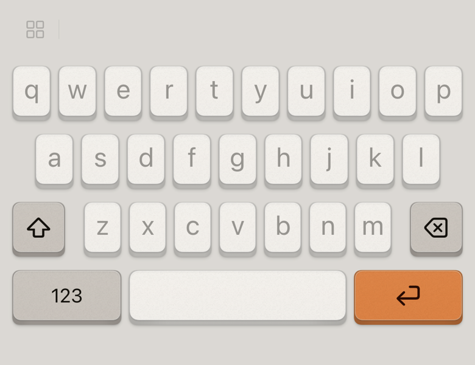</a> | <a href="Themes/beams.clinktheme"><strong>Beams Dark</strong></a><br><a href="README-assets/previews/beams-dark.png"></a> |
| <a href="Themes/beams-blue.clinktheme"><strong>Blue Light</strong></a><br><a href="README-assets/previews/beams-blue-light.png">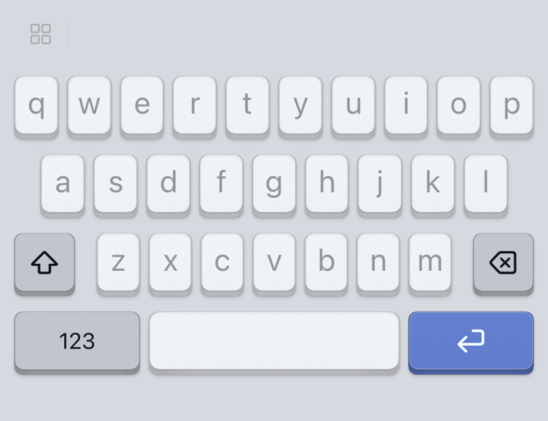</a> | <a href="Themes/beams-blue.clinktheme"><strong>Blue Dark</strong></a><br><a href="README-assets/previews/beams-blue-dark.png">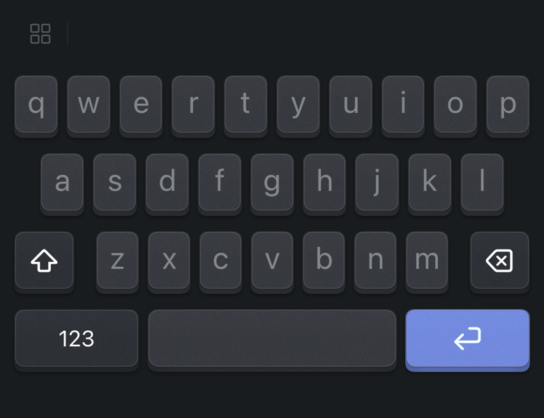</a> |
| <a href="Themes/beams-green.clinktheme"><strong>Green Light</strong></a><br><a href="README-assets/previews/beams-green-light.png">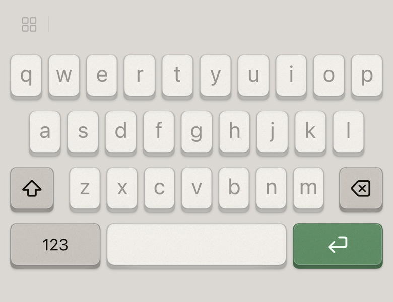</a> | <a href="Themes/beams-green.clinktheme"><strong>Green Dark</strong></a><br><a href="README-assets/previews/beams-green-dark.png">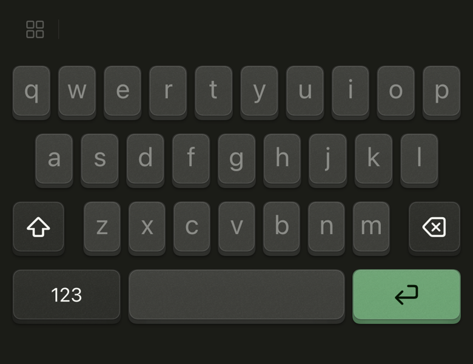</a> |
| <a href="Themes/beams-yellow.clinktheme"><strong>Yellow Light</strong></a><br><a href="README-assets/previews/beams-yellow-light.png">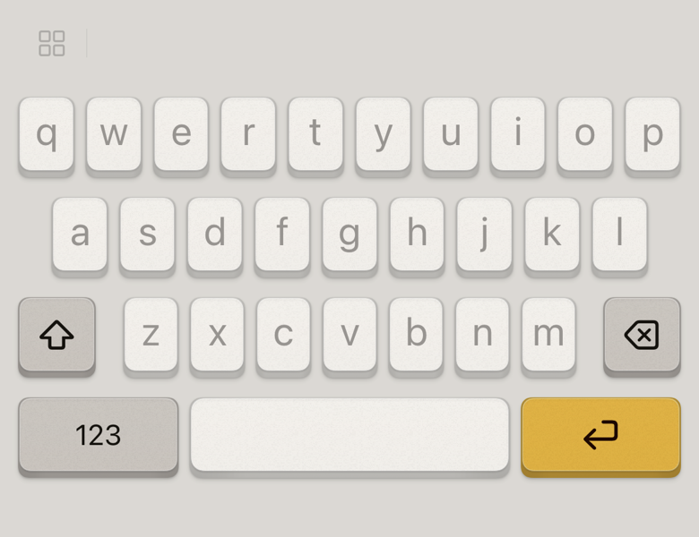</a> | <a href="Themes/beams-yellow.clinktheme"><strong>Yellow Dark</strong></a><br><a href="README-assets/previews/beams-yellow-dark.png">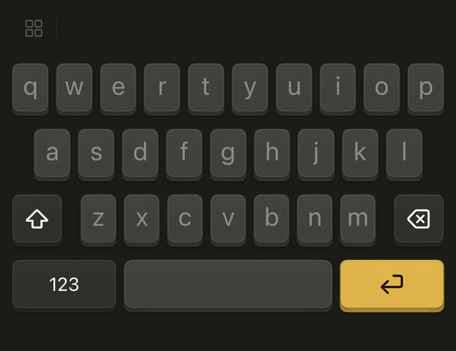</a> |
| <a href="Themes/beams-red.clinktheme"><strong>Red Light</strong></a><br><a href="README-assets/previews/beams-red-light.png"></a> | <a href="Themes/beams-red.clinktheme"><strong>Red Dark</strong></a><br><a href="README-assets/previews/beams-red-dark.png">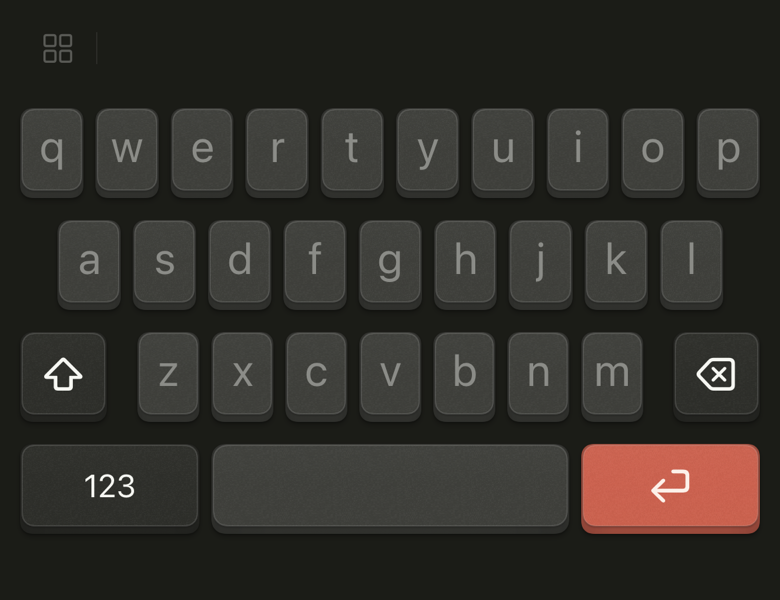</a> |
| <a href="Themes/beams-sand.clinktheme"><strong>Sand Light</strong></a><br><a href="README-assets/previews/beams-sand-light.png">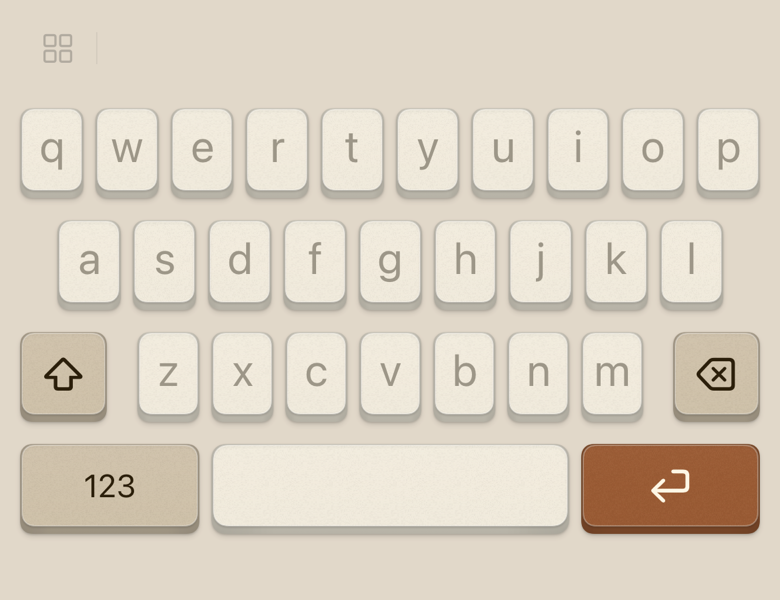</a> | <a href="Themes/beams-sand.clinktheme"><strong>Sand Dark</strong></a><br><a href="README-assets/previews/beams-sand-dark.png">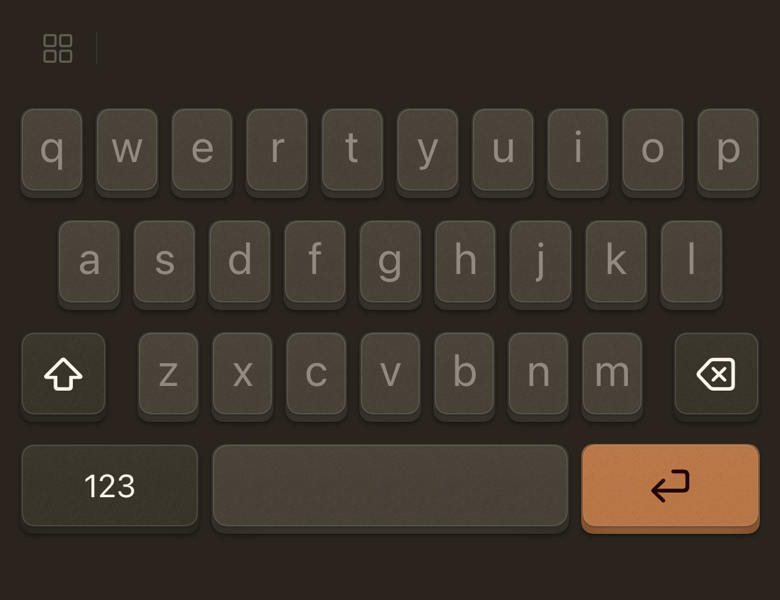</a> |
| <a href="Themes/beams-olive.clinktheme"><strong>Olive Light</strong></a><br><a href="README-assets/previews/beams-olive-light.png">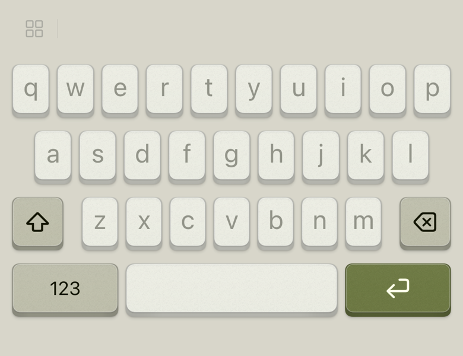</a> | <a href="Themes/beams-olive.clinktheme"><strong>Olive Dark</strong></a><br><a href="README-assets/previews/beams-olive-dark.png">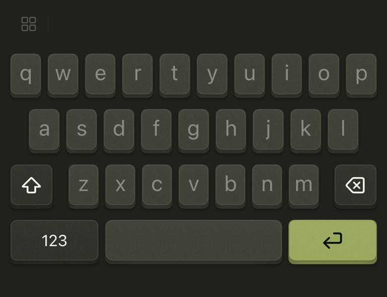</a> |
| <a href="Themes/beams-pink.clinktheme"><strong>Pink Light</strong></a><br><a href="README-assets/previews/beams-pink-light.png">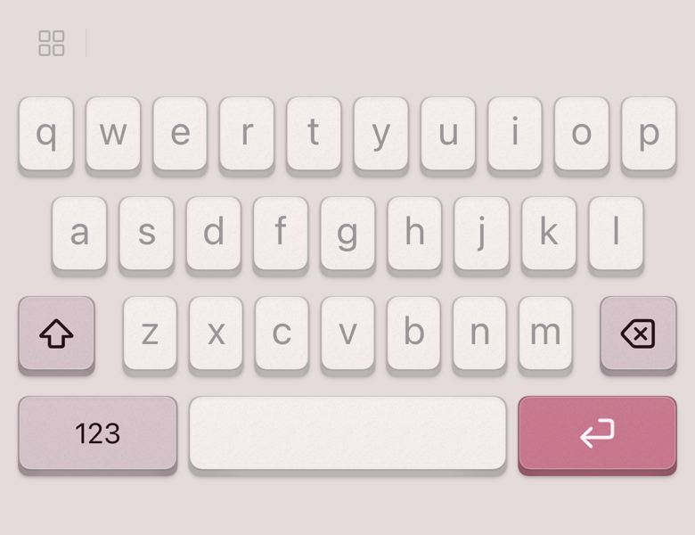</a> | <a href="Themes/beams-pink.clinktheme"><strong>Pink Dark</strong></a><br><a href="README-assets/previews/beams-pink-dark.png">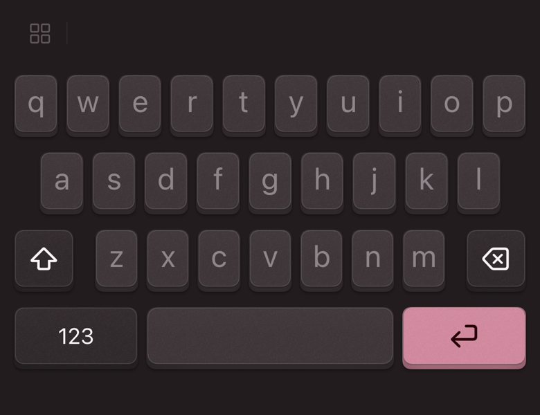</a> |
| <a href="Themes/beams-mono.clinktheme"><strong>Mono Light</strong></a><br><a href="README-assets/previews/beams-mono-light.png">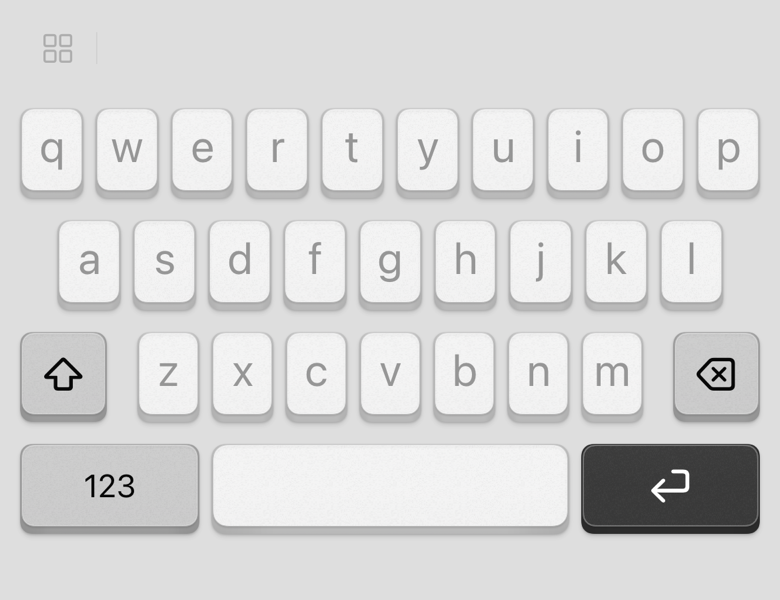</a> | <a href="Themes/beams-mono.clinktheme"><strong>Mono Dark</strong></a><br><a href="README-assets/previews/beams-mono-dark.png">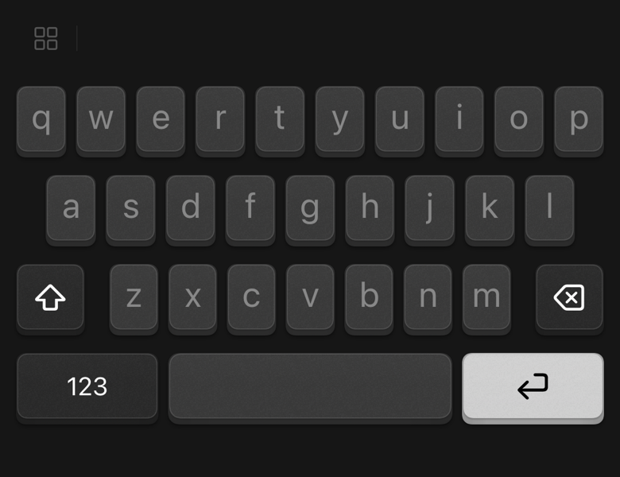</a> |
| <a href="Themes/beams-classic.clinktheme"><strong>Classic Light</strong></a><br><a href="README-assets/previews/beams-classic-light.png">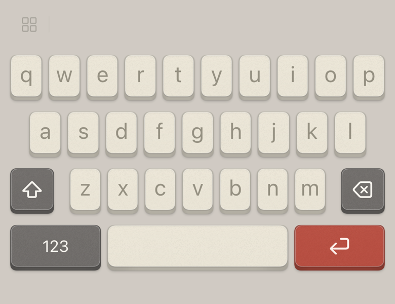</a> | <a href="Themes/beams-classic.clinktheme"><strong>Classic Dark</strong></a><br><a href="README-assets/previews/beams-classic-dark.png">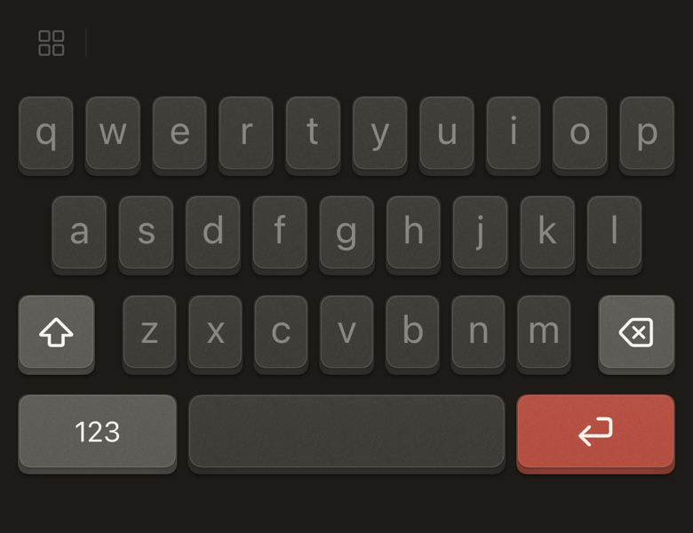</a> |
| <a href="Themes/beams-rose.clinktheme"><strong>Rosé Light</strong></a><br><a href="README-assets/previews/beams-rose-light.png">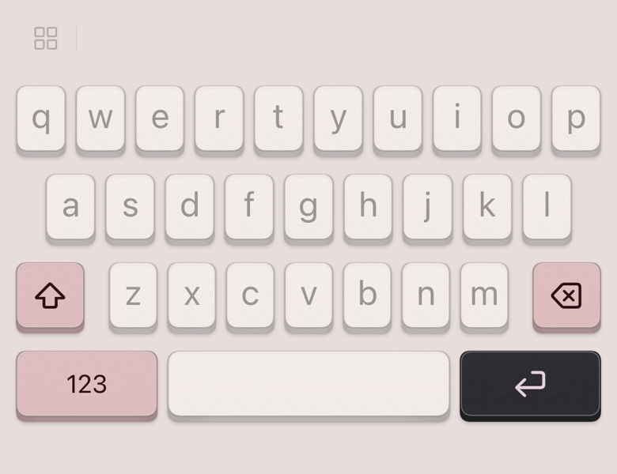</a> | <a href="Themes/beams-rose.clinktheme"><strong>Rosé Dark</strong></a><br><a href="README-assets/previews/beams-rose-dark.png"></a> |
| <a href="Themes/beams-botanical.clinktheme"><strong>Botanical Light</strong></a><br><a href="README-assets/previews/beams-botanical-light.png">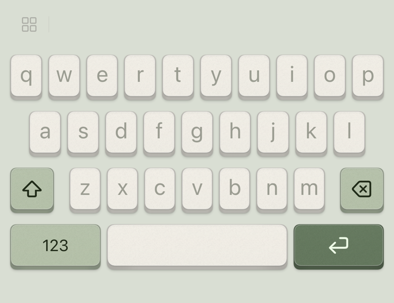</a> | <a href="Themes/beams-botanical.clinktheme"><strong>Botanical Dark</strong></a><br><a href="README-assets/previews/beams-botanical-dark.png">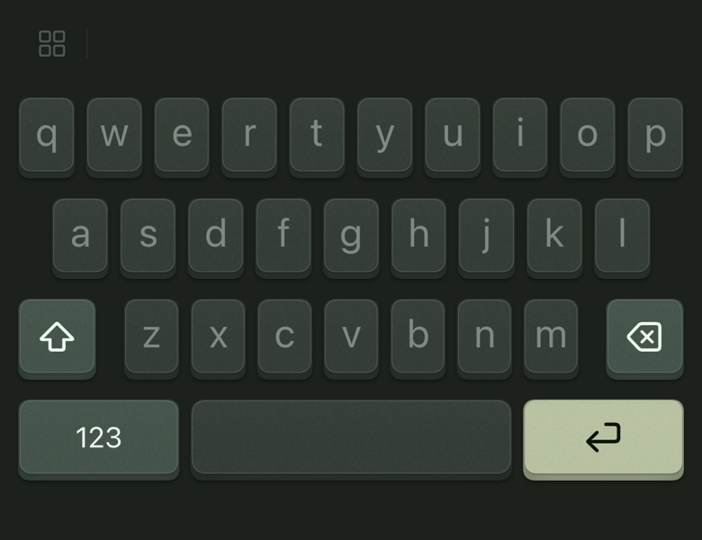</a> |
| <a href="Themes/beams-laser.clinktheme"><strong>Laser Light</strong></a><br><a href="README-assets/previews/beams-laser-light.png"></a> | <a href="Themes/beams-laser.clinktheme"><strong>Laser Dark</strong></a><br><a href="README-assets/previews/beams-laser-dark.png">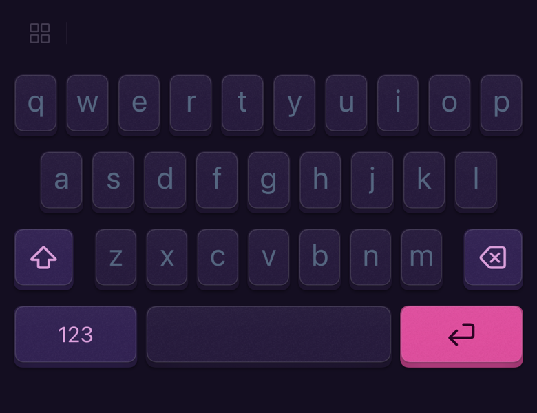</a> |
| <a href="Themes/beams-nordic.clinktheme"><strong>Nordic Light</strong></a><br><a href="README-assets/previews/beams-nordic-light.png">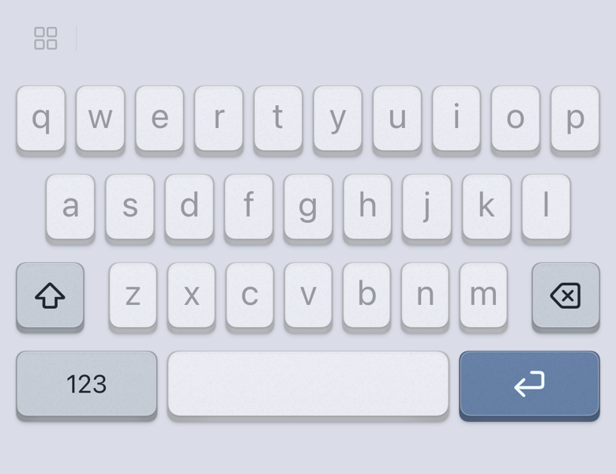</a> | <a href="Themes/beams-nordic.clinktheme"><strong>Nordic Dark</strong></a><br><a href="README-assets/previews/beams-nordic-dark.png">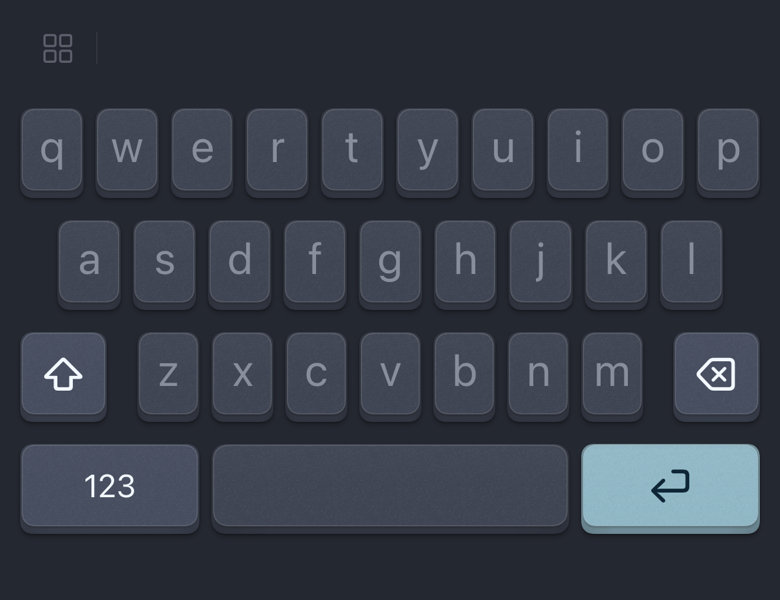</a> |
| <a href="Themes/beams-purple.clinktheme"><strong>Purple Light</strong></a><br><a href="README-assets/previews/beams-purple-light.png">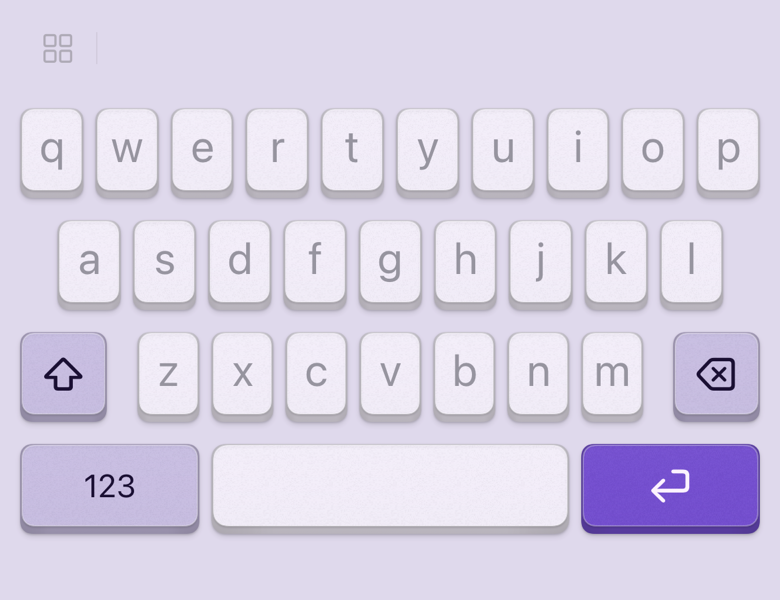</a> | <a href="Themes/beams-purple.clinktheme"><strong>Purple Dark</strong></a><br><a href="README-assets/previews/beams-purple-dark.png">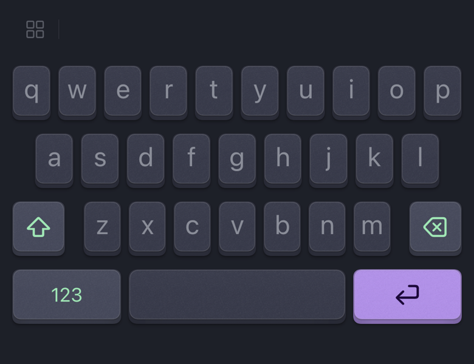</a> |
| <a href="Themes/beams-carbon.clinktheme"><strong>Carbon Light</strong></a><br><a href="README-assets/previews/beams-carbon-light.png">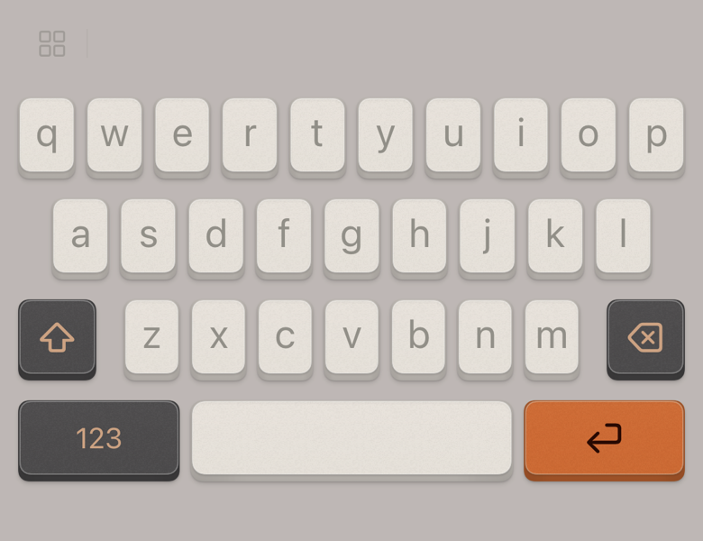</a> | <a href="Themes/beams-carbon.clinktheme"><strong>Carbon Dark</strong></a><br><a href="README-assets/previews/beams-carbon-dark.png">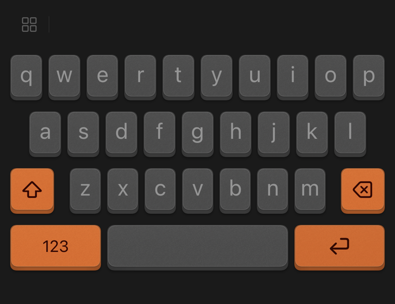</a> |
| <a href="Themes/beams-miami.clinktheme"><strong>Miami Light</strong></a><br><a href="README-assets/previews/beams-miami-light.png">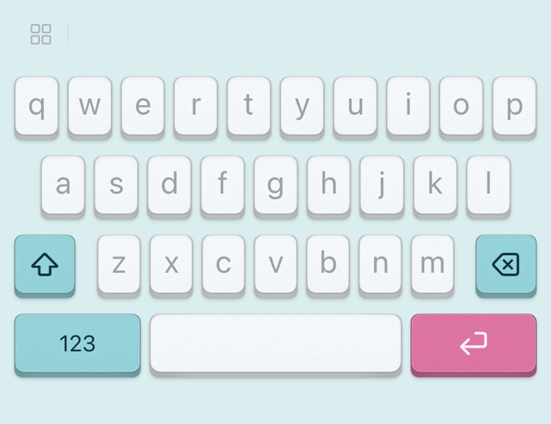</a> | <a href="Themes/beams-miami.clinktheme"><strong>Miami Dark</strong></a><br><a href="README-assets/previews/beams-miami-dark.png">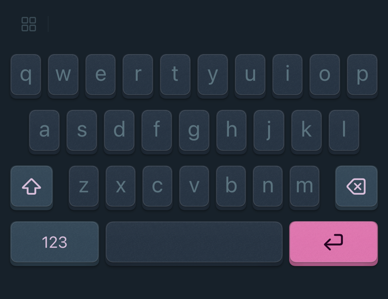</a> |
| <a href="Themes/beams-navy.clinktheme"><strong>Navy Light</strong></a><br><a href="README-assets/previews/beams-navy-light.png">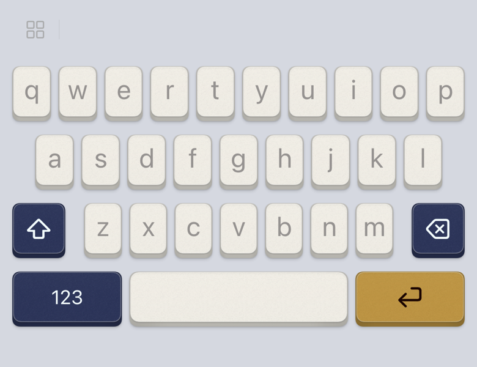</a> | <a href="Themes/beams-navy.clinktheme"><strong>Navy Dark</strong></a><br><a href="README-assets/previews/beams-navy-dark.png">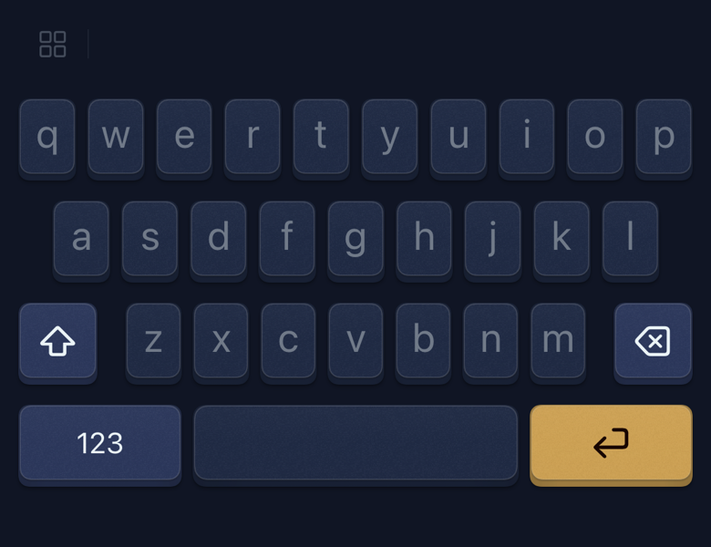</a> |
| <a href="Themes/beams-lavender.clinktheme"><strong>Lavender Light</strong></a><br><a href="README-assets/previews/beams-lavender-light.png">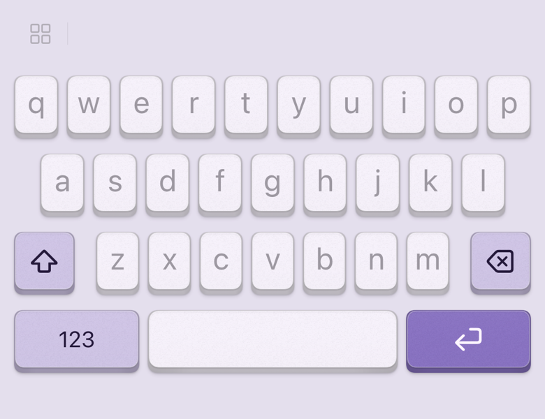</a> | <a href="Themes/beams-lavender.clinktheme"><strong>Lavender Dark</strong></a><br><a href="README-assets/previews/beams-lavender-dark.png">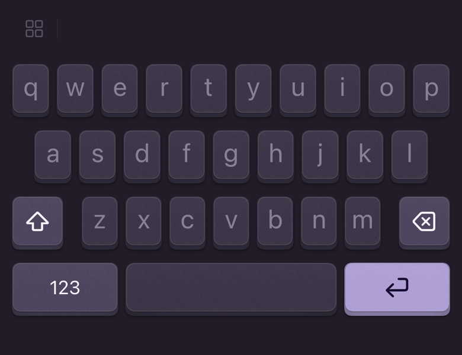</a> |
| <a href="Themes/beams-samurai.clinktheme"><strong>Samurai Light</strong></a><br><a href="README-assets/previews/beams-samurai-light.png">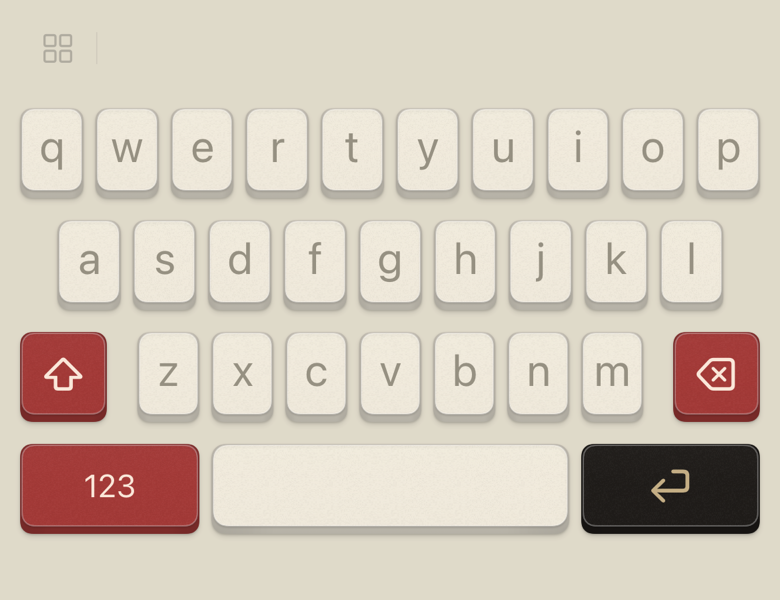</a> | <a href="Themes/beams-samurai.clinktheme"><strong>Samurai Dark</strong></a><br><a href="README-assets/previews/beams-samurai-dark.png">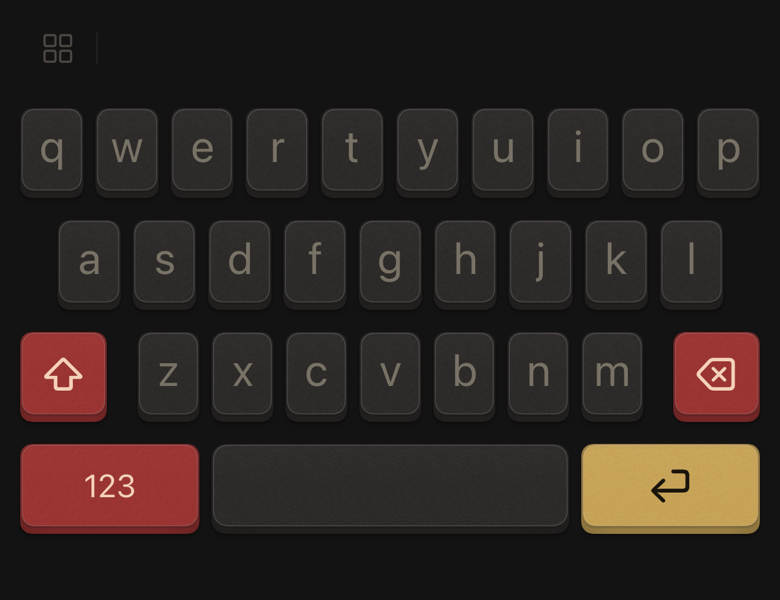</a> |
| <a href="Themes/beams-terminal.clinktheme"><strong>Terminal Light</strong></a><br><a href="README-assets/previews/beams-terminal-light.png">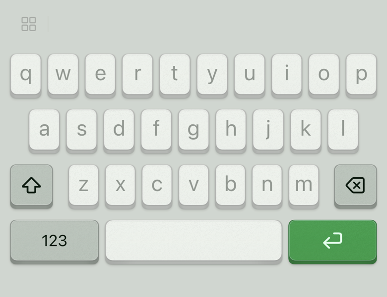</a> | <a href="Themes/beams-terminal.clinktheme"><strong>Terminal Dark</strong></a><br><a href="README-assets/previews/beams-terminal-dark.png">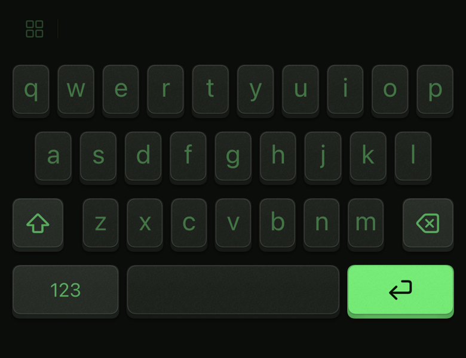</a> |
| <a href="Themes/beams-coffee.clinktheme"><strong>Coffee Light</strong></a><br><a href="README-assets/previews/beams-coffee-light.png">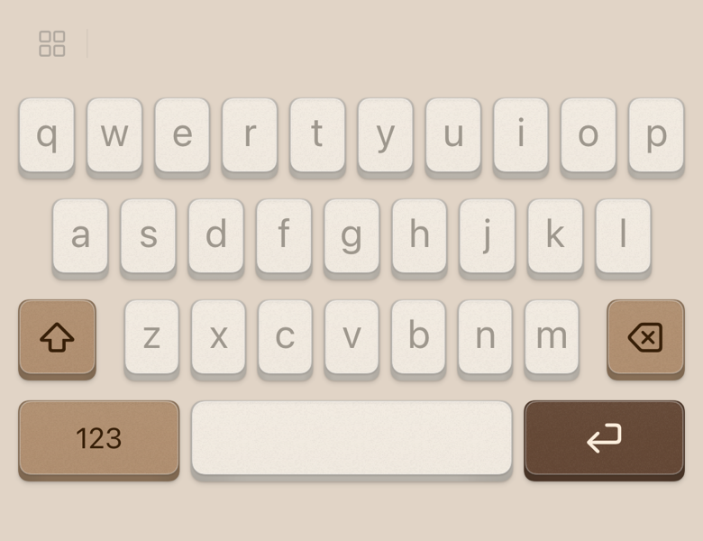</a> | <a href="Themes/beams-coffee.clinktheme"><strong>Coffee Dark</strong></a><br><a href="README-assets/previews/beams-coffee-dark.png">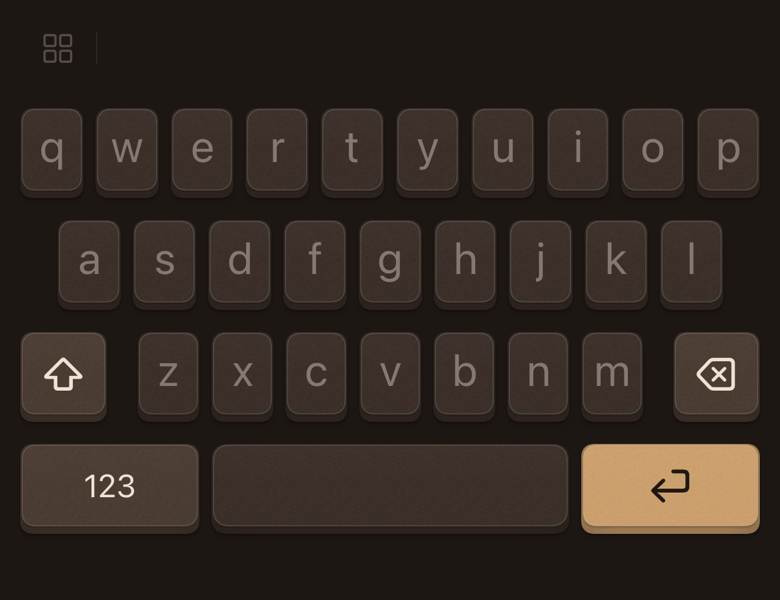</a> |

The complete collection is under [`Themes/`](Themes). [`catalog.json`](catalog.json) lists the themes in their display order.
<!-- theme-gallery:end -->

The previews are captured from Clink for iOS, using the themes in this repository. They show Clink's keyboard layout; key sizes, spacing, and optional hints follow your own settings.

## Use a Beams theme

In Clink builds that include this collection, open **Customize → Look → Beams** and choose a theme. The themes are bundled with Clink for iOS and Android, so they are free and available offline. Each theme includes a light and a dark appearance for Clink's existing appearance selection.

To customise a theme, make an editable copy in Clink. You can change its colours, key style, material, depth, and material adjustments, then choose **Export** from the theme menu to save a `.clinktheme` file.

## Make your first theme

You do not need to build Clink to edit the collection.

1. Copy this repository.
2. Add a colourway to [`palettes.json`](palettes.json), following an existing entry. Give it a permanent lowercase `id` beginning with `beams-` and a clear visible `name`.
3. Supply both `light` and `dark` palettes. Each appearance has separate background, letter key, function key, and Return key colours.
4. The generator checks that the curated collection contains 22 themes and begins with Beams. If you are intentionally adding or removing a theme, update the collection count in `tools/generate.py`. Keep the existing IDs stable.
5. Generate and check the paired theme documents:

   ```sh
   python3 tools/generate.py
   python3 tools/generate.py --check
   ```

6. Open the generated `.clinktheme` file in Clink and check both appearances before sharing it.

The palette table is the editable source for this collection. Regenerating replaces the files in `Themes/`, so put collection changes in `palettes.json`. Exported personal themes can be kept separately.

## Make a theme with an AI agent

Give an AI coding agent the instructions in [`PROMPT.md`](PROMPT.md), then describe the colourway you want. The prompt explains the paired format, editable palette source, and validation commands. Review both appearances in Clink before sharing the result.

## What Clink verifies

Beams themes contain appearance data only. Each `.clinktheme` has one stable identity and a complete light/dark pair. The collection check verifies that the theme documents and catalog match their source palettes.

Clink checks theme documents when they are imported. Theme files cannot contain executable code. These themes contain no photographs or custom typing behaviour.

## Refresh the previews

In the Clink app repository, run `captureBeamsPairedTheme` in an app-hosted iOS simulator. It captures every theme's light and dark keyboard appearance and prints each file's location with `KEY_MATERIAL_QA`.

Pass that capture directory to the gallery importer:

```sh
python3 tools/update-readme-gallery.py /path/to/native-captures
```

The importer keeps the native PNGs unchanged and records their hashes alongside the theme hashes. It updates the gallery only when all 44 appearances are present.

## Licensing

These themes and tools use the [Clink Community Assets License 1.0](LICENSE.md). You can use, modify, and share them for free with Clink under that licence. Include the licence when sharing a modified copy.
